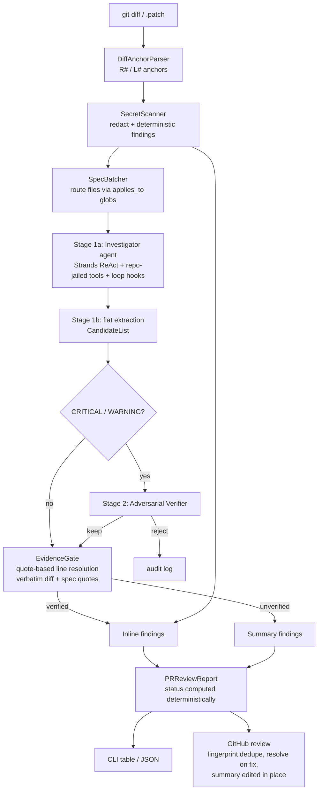

# SpecGuard — Agentic PR & System-Spec Compliance Reviewer

An agentic pull-request reviewer built with **Python** and the **Strands Agents SDK** that catches cross-file architectural drift, security regressions, and code-quality issues against repository-local Markdown specifications (`.spec/*.md`).

## Architecture Highlights
- **Anchor-Based Diff Mapping (`[R42]`, `[L17]`):** Eliminates LLM line-number hallucinations and translates anchors safely into GitHub PR Review API `line` + `side` coordinates. The final line is chosen by where the verified `evidence_diff_quote` actually appears, and the model's anchor only breaks ties. Anchors that miss by up to ±3 lines snap to the nearest diff line, and every move is recorded in the audit log.
- **Deterministic Evidence Gate (Zero Trust in Self-Reported Confidence):** Every finding must pass exact substring verification against both the diff (`evidence_diff_quote`) and an accessed spec section (`evidence_spec_quote`), plus diff-hunk anchor validation before becoming an inline comment.
- **Strands Loop-Control Hooks:** Uses `BeforeModelCallEvent` to enforce hard iteration caps and `BeforeToolCallEvent` (`event.cancel_tool`) to block duplicate tool invocations.
- **Two-Stage Portable Pipeline:** Decouples tool-using ReAct investigation from flat Pydantic extraction so small local models (Ollama) and cloud models (Gemini) share identical schemas.
- **Adversarial Verifier Agent:** Challenges `CRITICAL` and `WARNING` candidates against surrounding repo context to suppress false positives.
- **Pre-LLM Secret Redaction:** A deterministic scanner flags credentials on added lines and redacts them everywhere (context lines and tool output too) before any text reaches a model.
- **Idempotent PR Re-Runs:** Each comment carries a fingerprint built from the file, category, spec section and quoted code, so pushing new commits never re-posts a known finding. A comment is marked resolved only when its code actually changed, the summary is one comment edited in place, and a blocking review is dismissed once the PR passes.

## Pipeline



## Execution Environments & Provider Abstraction

| Mode (`SPECGUARD_PROVIDER`) | Where It Runs | Inference Backend | Cost | Purpose |
| :--- | :--- | :--- | :--- | :--- |
| **`replay`** *(Default)* | Laptop / GitHub Actions CI | Local JSON Cassettes (`evals/cassettes/`) | **$0** | Offline unit tests, deterministic CI regression gates, zero GPU usage. |
| **`ollama`** | Google Colab T4 GPU / Local | Local Ollama (`qwen2.5-coder:7b` or `3b`) | **$0** | Full golden-dataset eval sweeps, ablation tables, recording cassettes. |
| **`gemini`** | GitHub Actions / Local CLI | Google AI Studio (`gemini-2.5-flash`) | **$0** | Live PR reviews on GitHub pull requests with token-bucket rate limiting. |

> Record cassettes once with `specguard record-cassettes` against a live provider (`--resume` continues after a rate-limit stop). Cassette keys include a hash of the spec and rulebook text, so editing a spec invalidates its recordings. Until cassettes exist, `replay` mode only reports the deterministic (secret-scanner) findings.

## Quickstart

```bash
python -m venv .venv && source .venv/bin/activate
pip install -e ".[dev]"

# 1. Run offline unit tests & cassette evals ($0, instant)
pytest
SPECGUARD_PROVIDER=replay specguard eval --ablation

# 2. Record cassettes for the golden dataset, then replay them offline
SPECGUARD_PROVIDER=ollama specguard record-cassettes
SPECGUARD_PROVIDER=replay specguard eval --ablation

# 3. Run on a real PR diff with Ollama (Colab T4 or local)
pip install -e ".[ollama]"
SPECGUARD_PROVIDER=ollama SPECGUARD_OLLAMA_MODEL=qwen2.5-coder:7b \
  specguard review --diff-file evals/dataset/case_01_spec_drift_money/diff.patch

# 4. Run with Gemini Free Tier
pip install -e ".[gemini]"
export GEMINI_API_KEY="your-key"
SPECGUARD_PROVIDER=gemini specguard review --base main --head HEAD
```

## Configuration

| Variable | Default | Purpose |
| :--- | :--- | :--- |
| `SPECGUARD_PROVIDER` | `replay` | `replay`, `ollama`, or `gemini` |
| `SPECGUARD_OLLAMA_MODEL` | `qwen2.5-coder:7b` | Ollama model tag |
| `SPECGUARD_OLLAMA_CTX` | `8192` | Ollama context window |
| `OLLAMA_HOST` | `http://localhost:11434` | Ollama endpoint |
| `SPECGUARD_GEMINI_MODEL` | `gemini-2.5-flash` | Gemini model id |
| `SPECGUARD_GEMINI_RPM` | `5` | Requests/minute for Gemini, enforced on every model call |
| `SPECGUARD_OLLAMA_RPM` | `600` | Requests/minute for Ollama |
| `SPECGUARD_TRACE` | off | `console` or `otlp`: emit OpenTelemetry spans (same as `specguard --trace ...`) |

### Tracing

```bash
specguard --trace console review --diff-file examples/demo_pr.patch
pip install -e ".[trace]"   # OTLP exporter
OTEL_EXPORTER_OTLP_ENDPOINT=http://localhost:4318 specguard --trace otlp eval --ablation
```

Live runs include Strands' own agent, model and tool-call spans. SpecGuard adds `specguard.review`, `specguard.batch` (with the tool-call sequence, also when replaying), `specguard.verify` (each verdict and its reason) and `specguard.evidence_gate` (every demotion, move and snap).

## Writing Specs

Each `.spec/*.md` file declares which paths it governs in YAML front matter; every `## Heading` becomes a citable section:

```markdown
---
applies_to:
  - "db/migrations/**"
---
# Data Model Specification

## Money
All monetary amounts ... MUST be stored as 64-bit integer cents.
```

Language rulebooks live in `.spec/rules/<language>_best_practices.md` and are loaded on demand by the agent.

SpecGuard reviews itself the same way: [`.spec/SYSTEM_SPEC.md`](.spec/SYSTEM_SPEC.md) governs `src/specguard/**` and states the project's architectural invariants:
- models cite only diff anchors
- the review status is computed deterministically
- inline findings need verbatim evidence
- every model call goes through the provider factory
- tools are jailed to the repository
- secrets are redacted before any model sees them
- diff text is treated as untrusted input

`tests/test_system_spec.py` enforces the mechanically checkable rules on every CI run.

## Demo

[`examples/demo_pr.patch`](examples/demo_pr.patch) is a four-file FastAPI payments PR with four planted problems: FLOAT money, a missing `Idempotency-Key` check, a logged email address, and a prompt-injection comment telling the reviewer to pass it. [`examples/demo_pr_fixed.patch`](examples/demo_pr_fixed.patch) is the corrected PR.

```bash
SPECGUARD_PROVIDER=ollama specguard demo
```

The demo passes only if the broken PR **FAIL**s with all three violations caught (despite the injection) and the fixed PR **PASS**es. See [examples/README.md](examples/README.md).

## Evaluation

`specguard eval` scores the pipeline against 35 golden PR diffs in `evals/dataset/`: 9 spec-drift, 9 security, 7 code-quality and 10 true-negative cases, including cross-file and prompt-injection PRs. See [evals/dataset/README.md](evals/dataset/README.md) for the labeling rubric.

Predictions are matched one-to-one to golden findings with the Hungarian algorithm (`scipy.optimize.linear_sum_assignment`). The scorer reports:

| Metric | Meaning |
| :--- | :--- |
| Precision / Recall | Over inline findings, matched by file, category and an acceptable line |
| Exact Line Acc | Matched findings placed on the golden primary line |
| Severity Acc | Matched findings with the golden severity |
| Citation Acc | Matched findings citing the golden spec section |
| Latency | Wall-clock time for the whole dataset |

`--ablation` compares three configurations: **Single-Shot Baseline** (one call with every rule inlined, no tools, no quote checks), **Investigator + Tools + EvidenceGate**, and **Full SpecGuard + Verifier**. `--runs N` repeats each configuration and reports mean ± std. This is only meaningful with a live provider, since replay is deterministic.

## Model Compatibility Matrix

| Provider / model | Tool calling (Stage 1a) | Structured output (Stage 1b) | Rate limit | Status |
| :--- | :--- | :--- | :--- | :--- |
| `replay` (cassettes) | n/a: replays recorded results | n/a | none | ✅ Tested in CI on every push |
| `ollama` · `qwen2.5-coder:7b` | Native Ollama tool calls | Flat `CandidateList` schema | `SPECGUARD_OLLAMA_RPM` (600) | ⏳ Not yet benchmarked |
| `ollama` · `qwen2.5-coder:3b` | Native Ollama tool calls; expect more loop-cap hits | Flat schema with one validation retry | `SPECGUARD_OLLAMA_RPM` (600) | ⏳ Not yet benchmarked |
| `gemini` · `gemini-2.5-flash` | Native function calling | Flat `CandidateList` schema | `SPECGUARD_GEMINI_RPM` (5), one call every 12s | ⏳ Not yet benchmarked |

The flat extraction schema and loop caps exist so small local models stay usable. The status column will be updated from real `specguard eval` runs.

## Evaluation & Ablation Benchmarks

> ⏳ **Pending a live run.** Populate with:
> ```bash
> SPECGUARD_PROVIDER=ollama specguard record-cassettes
> SPECGUARD_PROVIDER=replay specguard eval --ablation
> ```
> The table below will be filled in from that exact output. No numbers are shown until then.

| Configuration | Precision | Recall | Exact Line Acc | Severity Acc | Citation Acc | Latency |
| :--- | :--- | :--- | :--- | :--- | :--- | :--- |
| Single-Shot Baseline | — | — | — | — | — | — |
| Investigator + Tools + EvidenceGate | — | — | — | — | — | — |
| Full SpecGuard + Verifier | — | — | — | — | — | — |

## Architecture Decision Records

### ADR-1: A deterministic quote and anchor gate instead of LLM confidence
**Context.** LLM self-reported confidence is uncalibrated, and models invent line numbers and quotes, especially small local ones.
**Decision.** A finding becomes an inline comment only if its quoted code appears verbatim in the diff, its spec quote appears verbatim in a section the agent actually loaded, and it resolves to a real diff line. The comment's line is chosen by where the quoted code appears. Pass/fail status is computed from validated severities, never taken from the model.
**Consequences.** Hallucinated findings are demoted to the summary instead of reaching developers. Real issues reported with sloppy quotes are demoted too, which costs some recall. The single-shot baseline in the ablation measures exactly that trade-off.

### ADR-2: Spec-section batching instead of per-file batching
**Context.** Architectural drift is often cross-file: a migration and the handler that writes to it, reviewed separately, each look fine.
**Decision.** Changed files are grouped under every spec whose `applies_to` globs match them, and each spec batch is reviewed in one investigation with all its files in context. Duplicate reports (a file under two specs, or a model repeating a scanner hit) are removed afterwards.
**Consequences.** Cross-file rules can be checked, and each prompt carries one spec's sections rather than every rule. The cost is that a file matched by several specs is investigated more than once.

### ADR-3: VCR cassette replay with Ollama as the default live backend for $0 evals
**Context.** Evals must run on every push without API spend or a GPU, and live LLM output is non-deterministic.
**Decision.** Live runs record each investigation, together with the spec text the agent read, to `evals/cassettes/`. Recordings are keyed on the diff plus a hash of the spec and rulebook text. `replay` is the default provider. Ollama on a Colab T4 is the recording backend; Gemini's free tier is for live PR reviews.
**Consequences.** CI evals are free and fully deterministic, and editing a spec automatically invalidates its stale recordings. Replay can only measure what was recorded, so metrics are refreshed by re-running `record-cassettes`.

## Project Layout

```
.spec/                     Architectural specs, SYSTEM_SPEC (self-review), language rulebooks
src/specguard/
  preprocessor/            Diff anchoring, secret scanning, spec routing
  agent/                   Strands investigator, verifier, hooks, repo-jailed tools
  llm/                     Provider factory, token bucket, cassette store
  postprocessor/           Deterministic evidence gate
  github/                  PR review publisher
  cli.py                   `specguard review` / `demo` / `eval` / `record-cassettes`
evals/                     Golden dataset, cassettes, Hungarian scorer
examples/                  Demo PR with planted issues + fixed version
notebooks/                 Colab T4 demo
tests/                     Deterministic unit tests
```
